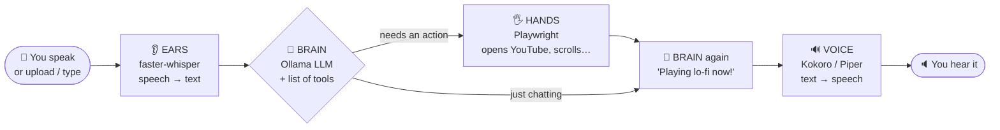

<div align="center">

# 🎙️ Voice Agent That Acts

### Talk to your computer. It talks back — **and does things.**

*Open YouTube · play a song · search Google · scroll · take a screenshot — all by voice.*

**100% local · 100% open source · no API keys · no cloud · no cost**


<sub>↑ Real recording of this repo running on a MacBook — the agent hears a command, picks a tool, acts, and answers out loud. (Recorded on a heavily loaded laptop, so it looks slower than normal — typical speeds are in [How fast is it?](#speed).)</sub>

</div>

---

## 📑 Contents
[How it works](#how-it-works) · [Quick start](#quick-start) · [Talk to it](#talk) · [Add your own tool](#add-tool) · [Browser & profile](#browser) · [Project map](#project-map) · [Settings](#settings) · [Troubleshooting](#troubleshooting) · [Speed](#speed) · [Contribute](#contributing)

---

<a id="how-it-works"></a>

## 🧠 How it works

A normal voice assistant is **ears → brain → voice**. This one adds **hands**.



**Example — you say:** *"open YouTube and play lo-fi music"*

| # | Who | What happens | Time |
|---|---|---|---|
| 1 | 👂 Ears | Audio becomes the text `Open YouTube and play lo-fi music.` | ~0.3 s |
| 2 | 🧠 Brain | LLM is shown your text **plus a menu of tools** and replies: *call `play_youtube("lofi music")`* | 0.5–2 s |
| 3 | 🖐️ Hands | Playwright opens Chromium and plays the top result | 2–3 s |
| 4 | 🧠 Brain | LLM is told what happened and says: *"Playing lo-fi music now!"* | first words ~1.5 s |
| 5 | 🔊 Voice | Kokoro speaks it through your speakers | streams instantly |

> ⭐ **What this workshop adds** is step 2–3: the [`app/tools/`](app/tools) folder — about 300 lines you can read in 10 minutes.

<table>
<tr>
<td width="50%"><b>The UI while it acts</b><br></td>
<td width="50%"><b>The agent's own browser (real screenshot taken by the agent)</b><br></td>
</tr>
</table>

---

<a id="quick-start"></a>

## 🚀 Quick start — from zero

⏱️ About **15 minutes**, almost all of it downloads. You need a laptop with ~8 GB free RAM.

### Step 0 — Install the basics *(one time)*

| Tool | Why | Mac | Linux (Ubuntu) | Windows |
|---|---|---|---|---|
| **Git** | get the code | `brew install git` | `sudo apt install git` | use **WSL2** (Ubuntu), follow the Linux column |
| **Python 3.12** *(3.11 OK, **not 3.13+**)* | runs the agent | `brew install python@3.12` | `sudo apt install python3.12 python3.12-venv python3-dev build-essential portaudio19-dev` | inside WSL |
| **Ollama** | the local AI brain | [ollama.com/download](https://ollama.com/download) | `curl -fsSL https://ollama.com/install.sh \| sh` | inside WSL |
| **ffmpeg + espeak-ng** | audio helpers | `brew install ffmpeg espeak-ng` | `sudo apt install ffmpeg espeak-ng` | inside WSL |

> 💡 Not sure what you have? Skip ahead — `./setup.sh` checks everything and tells you exactly what's missing.

### Step 1 — Get the code
```bash
git clone https://github.com/coder-irwin/voice-agent-workshop.git
cd voice-agent-workshop
```

### Step 2 — Install everything *(one command)*
```bash
./setup.sh
```
Creates a Python environment, installs packages, the Playwright browser, the voice models, and pulls the AI model (~2 GB). Safe to run again.

### Step 3 — Start the agent
```bash
./run.sh
```

### Step 4 — Talk to it 🎉
Open **http://localhost:8000** in **Chrome**, click **Start Listening**, allow the microphone, and say:

> **"Open YouTube and play lo-fi music."**

🎧 **Use headphones** — otherwise the agent hears its own voice (and your YouTube video!) and interrupts itself.


### ✅ Things to try saying

| Say… | It does… |
|---|---|
| "Open YouTube and play lo-fi music" | opens YouTube, plays the top result |
| "Search Google for open source voice agents" | Google search |
| "Open GitHub" | opens github.com |
| "Scroll down" | scrolls the page |
| "Take a screenshot" | saves `screenshots/shot_*.png` |
| "What time is it?" | tells you the time |
| "Roll a dice" | a tiny tool students wrote 🎲 |
| "How are you?" | just chats — **no** tool is used |

---

<a id="talk"></a>

## 🎙️ Three ways to talk to it

**A laptop microphone is NOT required.** All three go through the exact same pipeline, and the agent always **speaks back** through your speakers.

| | Option | How |
|---|---|---|
| 🎤 | **Microphone** | click *Start Listening* and speak |
| 🎧 | **Upload a voice file** | no mic (or it's blocked)? The session keeps working. Click **🎧 Upload a voice file** and pick any wav / mp3 / m4a — e.g. a recording from your phone |
| ⌨️ | **Type it** | the text box under the status bar — perfect for a noisy room |


<sub>↑ Captured in a browser with **no microphone at all**: an uploaded mp3 saying "open GitHub and scroll down" → two tool calls → spoken reply. (The latency numbers here are high because the laptop was low on memory — see [How fast is it?](#speed).)</sub>

### 🧪 Test without the browser

```bash
.venv/bin/python try_tools.py "play lofi music on youtube"   # text → tool (no audio at all)
.venv/bin/python voice_test.py "open github"                 # macOS speaks → full voice pipeline → ai_reply.wav
.venv/bin/python voice_test.py my_command.mp3                # any OS: send a recorded voice file (needs ffmpeg)
```

---

<a id="add-tool"></a>

## ✏️ Add your own tool — the workshop exercise

Open [`app/tools/my_tools.py`](app/tools/my_tools.py) and add:

```python
@tool
def tell_joke() -> str:
    """Tell the user a programming joke."""
    return "Why do programmers prefer dark mode? Because light attracts bugs."
```

Restart `./run.sh`, say **"tell me a joke"**. **That's it** — no other file to edit. 🎉

### The 3 rules
1. A normal Python function with **`@tool`** on top.
2. A clear **docstring** — the AI reads it to decide *when* to use your tool.
3. Return a **short string** — the agent says it out loud.

### Want it to use the browser?
```python
from .browser import browser

@tool
async def open_maps(place: str) -> str:
    """Open Google Maps for a place.

    Args:
        place: the place to look up, like "India Gate"
    """
    page = await browser.page()
    await page.goto(f"https://www.google.com/maps/search/{place}")
    return f"Opened Maps for {place}"
```
(Use `async def` for browser/network work, plain `def` otherwise. Copy `play_youtube` in [`builtin.py`](app/tools/builtin.py) as a template.)

### 💡 Project ideas for students
🌦️ weather (`https://wttr.in/<city>?format=3`) · 🗺️ Google Maps · 🎵 Spotify web · 🌍 translate a phrase · 📰 read the top headline · 🐙 open a specific GitHub repo · 📝 save a voice note to a file · 🔇 mute/pause the video

<details>
<summary><b>🔍 How does the AI know which tool to call? (click to expand)</b></summary>

1. `@tool` reads your function's **name, docstring and type hints** and builds a JSON description ("schema") — see [`registry.py`](app/tools/registry.py).
2. For every sentence you say, [`dispatcher.py`](app/tools/dispatcher.py) sends Ollama your text **plus all tool schemas**.
3. If the model decides an action is needed, it answers with a *tool call* (`name` + `arguments`) instead of text.
4. We run only **registered** functions (no shell access, unknown names are refused, invented arguments are dropped).
5. The result string goes back to the LLM so its spoken reply matches what really happened.

This uses Ollama's native tool-calling, so it works with any tool-capable local model (`qwen2.5`, `llama3.1`, …).
</details>

---

<a id="browser"></a>

## 🌐 Use a different browser or a saved profile

By default the agent opens a **fresh, empty Chromium** (installed by `setup.sh`). Want it to use **your Chrome**, **Edge**, **Firefox** — or stay **logged in** to YouTube/Gmail? Just edit `.env` — no code changes:

```ini
BROWSER=chrome                              # chromium | chrome | msedge | firefox | webkit
BROWSER_PROFILE_DIR=~/voice-agent-profile   # empty = fresh browser; a folder = remembered profile
```

| `BROWSER=` | Uses | Notes |
|---|---|---|
| `chromium` | Playwright's own Chromium | default, always installed by `setup.sh` |
| `chrome` | your **installed Google Chrome** | must be installed on your laptop |
| `msedge` | your **installed Microsoft Edge** | must be installed on your laptop |
| `firefox` | Playwright's Firefox | `setup.sh` downloads it for you if you set it |
| `webkit` | Playwright's WebKit (Safari engine) | `setup.sh` downloads it for you if you set it |

**Particular profile (stay logged in):**
1. Set `BROWSER_PROFILE_DIR` to a folder, e.g. `~/voice-agent-profile` (it's created automatically).
2. Start the agent and say *"open YouTube"*. **Log in once** in the window that opens.
3. From now on the agent opens with that login, cookies and history — even after restarts. Works with every browser above.

Test your choice in 10 seconds (run it **twice** with a profile set — the second run says *"welcome back"*):
```bash
.venv/bin/python check_browser.py
```

> ⚠️ **Use a dedicated profile folder, not your everyday Chrome profile.** A browser locks its profile while it's open, and recent Chrome versions restrict automation on the default profile — so pointing at your daily profile folder often fails. A dedicated folder (log in once) is reliable, and keeps the agent away from your personal data. *(We tested dedicated folders with Chrome and Firefox; we did not test pointing at a daily-use profile.)*
>
> Changed `BROWSER` after setup? Install it once: `.venv/bin/python -m playwright install firefox` (or `webkit`, `chrome`, `msedge`).

---

<a id="project-map"></a>

## 🗺️ Project map

```
voice-agent-workshop/
├── app/
│   ├── tools/                ⭐ THE ACTION LAYER — start here
│   │   ├── registry.py       @tool decorator: function → AI-callable tool
│   │   ├── dispatcher.py     asks the LLM "which tool?", runs it safely
│   │   ├── browser.py        one shared Playwright browser
│   │   ├── builtin.py        open_website, play_youtube, search_google, scroll, screenshot…
│   │   └── my_tools.py       ✏️ YOUR playground
│   ├── main.py               WebSocket server: audio → STT → tools → LLM → TTS → speaker
│   ├── stt.py                👂 faster-whisper (speech → text)
│   ├── llm.py                🧠 Ollama streaming client
│   ├── tts/                  🔊 Kokoro + Piper voices
│   └── vad.py                detects when you start / stop talking
├── index.html                the web UI (mic, upload, chat, action cards)
├── setup.sh · run.sh         one-command install / start
├── try_tools.py              test tools by typing
├── check_browser.py          test your BROWSER / profile choice
├── voice_test.py             automatic voice-to-voice test
└── docs/                     screenshots, demo, deep-dive of the base pipeline
```

---

<a id="settings"></a>

## ⚙️ Settings

Edit `.env` (created by `setup.sh` from `.env.example`):

| Setting | Default | Meaning |
|---|---|---|
| `OLLAMA_MODEL` | `qwen2.5:3b` | the brain. `llama3.1:8b` is smarter but slower |
| `TOOLS_ENABLED` | `1` | `0` = chat only, no actions |
| `TOOL_GATE` | `1` | `1` = a quick "command or just chat?" check runs first, so "hello" never triggers a tool. `0` = skip it |
| *Persona* (dropdown in the UI) | `Default` | a neutral assistant that knows its actions. `angelina`, `marcus`, `sophia` are optional sales/support demo personas from the original repo |
| `BROWSER` | `chromium` | `chromium` · `chrome` · `msedge` · `firefox` · `webkit` ([details](#browser)) |
| `BROWSER_PROFILE_DIR` | *(empty)* | folder = remembered profile / logins |
| `BROWSER_HEADLESS` | `0` | `1` hides the browser window |

---

<a id="troubleshooting"></a>

## 🛟 Troubleshooting

| Problem | Fix |
|---|---|
| `No module named 'pkg_resources'` | `.venv/bin/pip install "setuptools<81"` |
| `webrtcvad` fails to install | You're on Python 3.13+. Use **3.11 or 3.12** |
| "Could not start Ollama" | open the Ollama app, or run `ollama serve` in another terminal |
| "No microphone" message | expected on mic-less laptops or if permission was denied → upload a voice file or type |
| Agent keeps interrupting itself | use **headphones**; background noise counts as "you talking" |
| Everything is very slow | low free RAM → the laptop is swapping. Close other apps (browsers with many tabs are the worst) and restart `./run.sh` |
| First command is slow | first run loads models and launches Chromium; later ones are faster |
| A tool didn't trigger | make its docstring clearer; test with `try_tools.py`; try `OLLAMA_MODEL=llama3.1:8b` |
| Wrong word heard | speak a bit slower — the small `base.en` Whisper model is fast, not perfect |
| `… is not installed for Playwright` | run the `playwright install <browser>` command shown in the message |
| Not logged in to YouTube/Gmail | set `BROWSER_PROFILE_DIR`, log in once in the window the agent opens |
| Port 8000 busy | `pkill -f "uvicorn app.main"` then `./run.sh` |

---

<a id="speed"></a>

## ⏱️ How fast is it?

Measured on a MacBook (Apple Silicon, `qwen2.5:3b`) with **free memory available**, counted **from the moment you stop talking**:

| Step | Time |
|---|---|
| Speech → text | ~0.3 s |
| "Command or just chat?" check | ~0.5 s |
| LLM picks the tool | 0.5–2 s |
| Tool runs (browser) | 0.2–3 s |
| **First spoken word** | **~2.5 s** plain chat · **~4–5 s** quick action (time, scroll) · **~6–9 s** when a web page must load (YouTube) |

> ⚠️ **Slow? Check your memory first.** The 3B model + Chromium need roughly 6 GB of free RAM. On a laptop that is already swapping (many apps open), we saw the *same* commands take 2–4× longer, and slow page loads can even hit the 30 s browser timeout. Close other apps (especially browsers with many tabs) before the demo.

🚀 Faster? Use a smaller model, keep the browser open, or skip the router for chit-chat — *a great contribution idea!*

---

<a id="contributing"></a>

## 🤝 Contributing

Students: your first PR can be **one new tool**. See [CONTRIBUTING.md](CONTRIBUTING.md) for the 6-step recipe and checklist. Small PRs are very welcome!

## 📚 Learn more
The deep-dive docs for the underlying voice pipeline (VAD, memory, personas) are in [`docs/BACKEND_DEEP_DIVE.md`](docs/BACKEND_DEEP_DIVE.md). *Written for the original repo — ignore its Docker and path instructions; use `./setup.sh` and `./run.sh` here.*

---

<div align="center">

Built on top of [coder-irwin/minimal-voice-ai-system](https://github.com/coder-irwin/minimal-voice-ai-system) · Apache-2.0

**If this helped you, ⭐ the repo and build a tool!**

</div>
